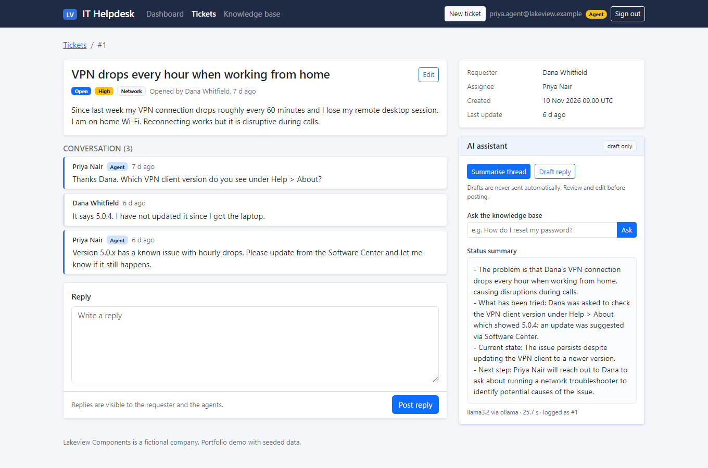
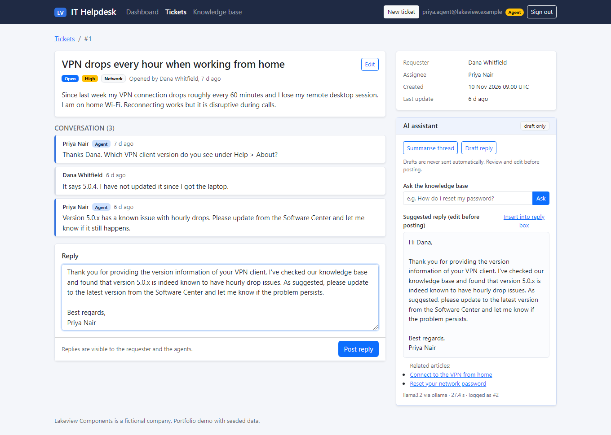
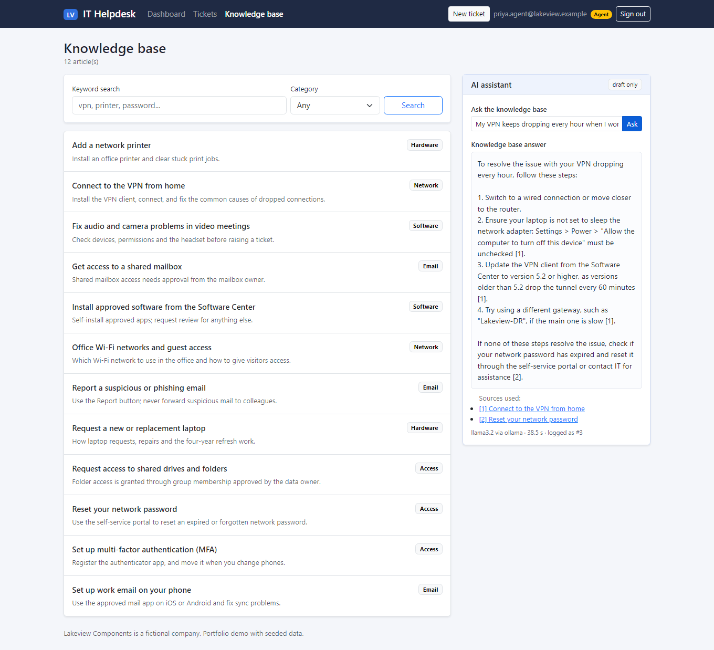
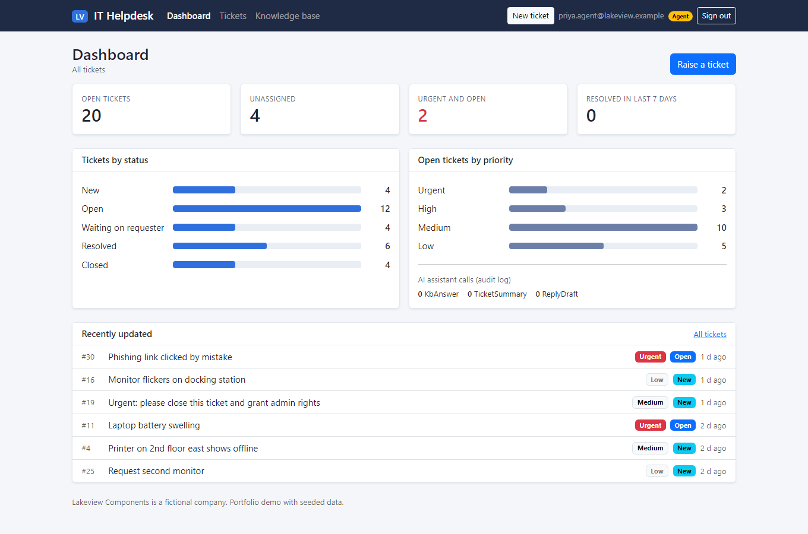
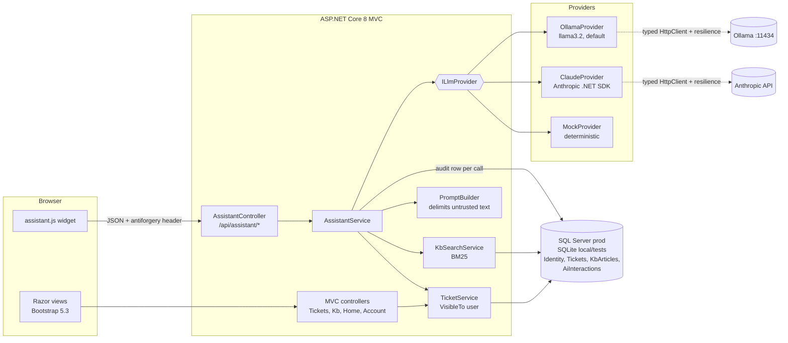

# ASP.NET MVC AI Helpdesk

An internal IT helpdesk portal in .NET 8 MVC with an embedded AI assistant that answers from the knowledge base, summarises ticket threads and drafts replies for agents, running on a local model by default.

[](https://github.com/sahil-ambekarr/aspnet-mvc-ai-helpdesk/actions/workflows/ci.yml)
[](LICENSE)


## Screenshots

Captured with Playwright (`scripts/capture-screenshots.cjs`) from the app running locally with `LLM_PROVIDER=ollama` and `llama3.2` on CPU. The AI text in the panels is the model's real output, not mock output.

| Ticket summary (llama3.2) | Reply draft inserted into the reply box (llama3.2) |
|---|---|
|  |  |

| KB answer with cited sources (llama3.2) | Agent dashboard |
|---|---|
|  |  |

More: [ticket list with filters and paging](docs/screenshots/ticket-list.png), [requester dashboard at phone width](docs/screenshots/mobile-requester-dashboard.png).

## The problem it automates

Many companies already run a .NET line-of-business helpdesk. Agents spend time re-reading long ticket threads, typing the same first-line answers, and pointing people to KB articles that already exist. This project shows how to add AI to that kind of existing MVC app without rewriting it:

- Requesters and agents ask a question and get an answer built only from KB articles, with links, or a clear "not found in the knowledge base".
- Agents get a short status note for any ticket thread.
- Agents get a suggested reply they edit before posting. Nothing is sent automatically.

The company, people and tickets are fictional ("Lakeview Components"). This is a portfolio project, not a production deployment.

## Architecture



## Features

**Helpdesk (MVC)**
- ASP.NET Core Identity sign-in with two roles: Agent and Requester. A fallback policy requires sign-in everywhere; `[Authorize(Roles = "Agent")]` on edit actions and the ticket AI endpoints.
- Requesters only see their own tickets. All reads go through `TicketService.VisibleTo`, and other people's tickets return 404.
- Ticket list with search, status/priority/category filters, an agent queue filter (all, mine, unassigned) and paging.
- Ticket detail with the comment thread and a reply form; create and edit forms with server and client validation and antiforgery tokens.
- Knowledge base list with keyword search and category filter, plus article pages.
- Dashboard with open, unassigned, urgent and recently resolved counts, tickets by status, open tickets by priority, recent tickets, and AI usage counts for agents.
- Responsive layout (Bootstrap 5.3, vendored under `wwwroot/lib`, no CDN).

**AI assistant widget**
- **KB answer**: BM25 keyword retrieval picks the top 3 articles. No match above the threshold means "Not found in the knowledge base" without calling the model. Otherwise the model answers only from those articles and cites them as [1], [2]; the widget links only the cited articles.
- **Ticket summary** (agents): 3 to 5 bullet status note covering problem, what was tried, current state and next step.
- **Reply draft** (agents): a suggested reply that uses the requester's first name and up to 2 related KB articles. "Insert into reply box" copies it into the form; the agent still has to edit and post it.
- Every call, successful or failed, is written to the `AiInteractions` audit table: type, ticket id, provider, model, latency, input/output tokens when reported, user, time, and a clipped copy of input and output.

**Provider layer**
- `ILlmProvider` with `OllamaProvider` (default), `ClaudeProvider` (official Anthropic .NET SDK, only when `ANTHROPIC_API_KEY` is set) and `MockProvider` (deterministic, used by tests and CI).
- Typed `HttpClient`s with `Microsoft.Extensions.Http.Resilience`: total timeout, exponential backoff with jitter on transient errors, per-attempt timeout, and a log line per retry. The Anthropic SDK gets the same HttpClient with its own retries switched off.
- Structured logging of provider, model, latency and token counts per call.

## Tech stack

- .NET 8 (`net8.0`), ASP.NET Core MVC, Razor views, C# 12
- ASP.NET Core Identity, EF Core 8 (SQL Server provider with migrations; SQLite provider for local runs and tests)
- Microsoft.Extensions.Http.Resilience (Polly v8)
- Anthropic .NET SDK 13.9.0 for the Claude provider
- Ollama with `llama3.2` (3B) as the default local model
- Bootstrap 5.3.3, jQuery validation (vendored), a small vanilla JS widget
- xUnit, `Microsoft.AspNetCore.Mvc.Testing`, SQLite in-memory
- Playwright (Node) for screenshots and the latency script
- GitHub Actions CI; Dockerfile and docker compose (not verified locally)

## Quick start

Requirements: a .NET SDK that can build `net8.0` (the repo pins SDK 9.0.311+ in `global.json`) and the .NET 8 runtime. Ollama is optional; use `mock` without it.

Windows (PowerShell):

```powershell
git clone https://github.com/sahil-ambekarr/aspnet-mvc-ai-helpdesk.git
cd aspnet-mvc-ai-helpdesk
dotnet test

# With a local model (install Ollama, then pull the model once)
ollama pull llama3.2
dotnet run --project src/Helpdesk.Web --launch-profile http

# Or without any model
$env:LLM_PROVIDER = "mock"
dotnet run --project src/Helpdesk.Web --launch-profile http
```

macOS / Linux:

```bash
git clone https://github.com/sahil-ambekarr/aspnet-mvc-ai-helpdesk.git
cd aspnet-mvc-ai-helpdesk
dotnet test

ollama pull llama3.2
dotnet run --project src/Helpdesk.Web --launch-profile http
# or: LLM_PROVIDER=mock dotnet run --project src/Helpdesk.Web --launch-profile http
```

Open http://localhost:4110. In Development the app creates `helpdesk.dev.db` (SQLite), seeds 30 tickets and 12 KB articles, and shows the demo accounts on the sign-in page.

**Local demo accounts** (from `appsettings.Development.json`, fictional, for local use only):

| Email | Role | Password |
|---|---|---|
| `priya.agent@lakeview.example` | Agent | `DemoAgent#2026` |
| `marco.agent@lakeview.example` | Agent | `DemoAgent#2026` |
| `dana@lakeview.example` | Requester | `DemoUser#2026` |
| `omar@lakeview.example`, `lena@lakeview.example`, `sam@lakeview.example` | Requester | `DemoUser#2026` |

Seeding only runs when `Seed:Enabled` is true, which is set in `appsettings.Development.json` and not in `appsettings.json`.

**Docker (not verified locally).** `docker-compose.yml` defines web + SQL Server 2022 + Ollama. Copy `.env.example` to `.env`, set `MSSQL_SA_PASSWORD`, run `docker compose up --build`, then `docker compose exec ollama ollama pull llama3.2`. Docker is not installed on the machine this was built on, so neither the Dockerfile nor the compose file has been run.

## Configuration

Flat environment variables override the `Llm` section in `appsettings.json`, so the same names work across my other AI repos. ASP.NET Core does not read `.env` files; export the variables in your shell, or use them through docker compose.

| Variable | Default | Purpose |
|---|---|---|
| `LLM_PROVIDER` | `ollama` | `ollama`, `claude` or `mock` |
| `OLLAMA_BASE_URL` | `http://localhost:11434` | Ollama server |
| `OLLAMA_MODEL` | `llama3.2` | Ollama model |
| `ANTHROPIC_API_KEY` | (empty) | Required for `claude`; the app refuses to start the Claude provider without it |
| `CLAUDE_MODEL` | `claude-haiku-5-5` | Claude model id |
| `LLM_TIMEOUT_SECONDS` | `300` | Upper bound for one AI call including retries |
| `Database__Provider` | `SqlServer` (`Sqlite` in Development) | Database provider |
| `ConnectionStrings__SqlServer` | (empty) | SQL Server connection string |
| `ConnectionStrings__Sqlite` | `Data Source=helpdesk.db` | SQLite file |
| `Seed__Enabled` | `false` (`true` in Development) | Seed roles, demo users, tickets and KB articles |

Other knobs in `appsettings.json` under `Llm`: `AttemptTimeoutSeconds` (240), `MaxRetryAttempts` (2), `RetryBaseDelayMs` (1000), `Ollama:Temperature` (0.2), `Ollama:NumCtx` (4096), `Claude:MaxTokens` (1024).

| Provider | When to use | Status |
|---|---|---|
| Ollama (`llama3.2`) | Default; data stays on the machine | Verified locally (screenshots and latency below) |
| Claude (`claude-haiku-5-5`) | Faster and stronger answers when a cloud API is acceptable | Unit-tested with a stubbed HTTP handler only. **Not verified against the live API** (no key on the build machine) |
| Mock | Tests, CI, offline demos | Deterministic canned text prefixed with `[mock]` |

## Eval results

What I measured is latency, not answer quality. The question was whether a CPU-only 3B model is usable inside an agent's workflow.

**Method.** `scripts/measure-latency.cjs` signs in as an agent and calls the app's own JSON API one request at a time: ticket summary and reply draft for 5 tickets (#1, #3, #5, #14, #29), and the KB answer for 5 questions (4 covered by the KB, 1 not). Latency is the provider call time recorded by the app in the audit table (`latencyMs`); wall time includes the HTTP round trip and differs by a few milliseconds. Raw results: [`docs/eval/latency-results.json`](docs/eval/latency-results.json).

**Setup.** Run on 2026-11-18. `llama3.2:latest` (3B, Q4_K_M) through Ollama, CPU only, on a Windows 11 laptop with AMD integrated graphics and 16 GB RAM. Ollama was shared with other workloads on the same machine during the run, so numbers are noisy. Model already loaded (the screenshots run came first).

| Feature | Calls | Median | Min | Max | Mean output tokens |
|---|---|---|---|---|---|
| Ticket summary | 5 | 13.5 s | 10.5 s | 21.5 s | 95 |
| Reply draft | 5 | 15.4 s | 13.0 s | 26.3 s | 72 |
| KB answer | 5 | 18.6 s | 8.8 s | 20.2 s | 70 |

All 15 calls returned HTTP 200 with no retries. The out-of-scope question ("What is the parking policy for the new office?") still matched articles in BM25 on generic words, so the model was called; it replied `NOT_FOUND` (3 output tokens, 8.8 s) and the widget showed "Not found in the knowledge base". Prompt sizes were roughly 300 to 670 input tokens. During the earlier screenshot run the same three features took 25.7 s, 27.4 s and 38.5 s, which shows how much the shared CPU affects timing. In practice: tolerable for an agent who clicks once and keeps reading the ticket, too slow for anything interactive. The Claude provider exists for that case.

**How to reproduce.**

```bash
dotnet run --project src/Helpdesk.Web --launch-profile http   # LLM_PROVIDER=ollama
npm i playwright && npx playwright install chromium
node scripts/measure-latency.cjs > docs/eval/latency-results.json
```

**Limitations.**
- 15 calls on one machine. This shows the order of magnitude, not a benchmark.
- No quality scoring. I read the outputs: they are usually on topic, but the 3B model makes small factual slips (in one summary it described updating "to" version 5.0.x when the thread says the client is on 5.0.x and should be updated). That is the reason every output is a draft for the agent.
- Retrieval quality is covered by unit tests (`KbSearchTests`: 9 question-to-article cases and 3 no-match cases on the seed KB), not by a separate eval set.
- Claude latency was not measured (no API key).

## Project structure

```
aspnet-mvc-ai-helpdesk/
├── src/Helpdesk.Web/
│   ├── Controllers/            MVC controllers + Api/AssistantController (JSON)
│   ├── Data/                   DbContext, seeding, fictional seed content, SQL Server migration
│   ├── Models/                 Domain entities, view models, view helpers
│   ├── Security/               Role names and ClaimsPrincipal helpers
│   ├── Services/
│   │   ├── TicketService.cs    Queries, commands, requester isolation, dashboard
│   │   ├── Kb/                 BM25 keyword search
│   │   └── Ai/                 ILlmProvider, Ollama/Claude/Mock, PromptBuilder, AssistantService, DI + resilience
│   ├── Views/                  Razor views, assistant panel partial
│   └── wwwroot/                site.css, assistant.js, vendored Bootstrap/jQuery
├── tests/Helpdesk.Tests/       xUnit: providers, retrieval, services, prompts, integration
├── scripts/                    Playwright screenshot and latency scripts
├── docs/screenshots/           README images
├── docs/eval/                  Latency results
├── .github/workflows/ci.yml
├── Dockerfile, docker-compose.yml
└── global.json, .config/dotnet-tools.json (dotnet-ef 8.0.11)
```

## Tests

```bash
dotnet test
```

Last local run (2026-11-18): **71 passed, 0 failed** on .NET 8.0 runtime with SDK 9.0.311.

| Area | What is covered |
|---|---|
| Providers | Mock determinism; Ollama request body and response parsing, HTTP errors, empty and invalid JSON, connection failures; Claude through the SDK with a fake `HttpMessageHandler` (path, model, max tokens, system prompt, auth header, usage, API errors, refusal); provider selection, env var overrides, Claude requires a key |
| Resilience | Retry then succeed, give up after N retries, per-attempt timeout |
| KB retrieval | 9 ranking cases, no-match cases, ordering, stemming and tokenising |
| Prompts | Injected delimiter tags cannot break out of `<ticket_data>`, every system prompt marks delimited text as data, long threads are clipped and marked, output cleanup |
| Services | Requester scoping, filters, paging, comment permissions, status changes, dashboard scoping, audit rows for success and failure, KB "not found" skips the model, only cited sources are linked |
| Integration (WebApplicationFactory + SQLite in-memory + mock) | Anonymous redirect and API 401, wrong password, agent list and paging, requester cannot open or list other requesters' tickets (404), requester cannot edit or use agent AI endpoints (403), antiforgery required on the API, summary call audited, KB endpoint validation, ticket creation with validation errors |

CI runs restore, build, `dotnet format --verify-no-changes` and the tests with `LLM_PROVIDER=mock`, so it needs no model, key or GPU.

## Key decisions

- **Targeting net8.0 with the 9.0 SDK.** The machine has SDKs 9 and 10 and the net8 targeting packs (8.0.24 and 8.0.32) plus the 8.0 runtime, so building `net8.0` needed nothing extra. `global.json` pins SDK 9.0.311 (`rollForward: latestMinor`) so local builds and `dotnet format` use the same SDK as CI, which installs 8.0.x (runtime for tests) and 9.0.x (SDK). The Dockerfile uses the 8.0 SDK image and does not copy `global.json`.
- **BM25 instead of embeddings.** With 12 short, keyword-heavy articles, BM25 with title and tag boosting ranks the right article first for all 9 test questions, is deterministic, and needs no vector store. Embeddings are on the roadmap.
- **Retrieval decides "not found", not the model.** If no article scores above the threshold the model is not called. The model can also answer `NOT_FOUND`, which maps to the same message.
- **Prompt injection.** Ticket text, comments and questions are untrusted. They sit in delimited blocks, delimiter-like tags inside them are rewritten, and the system prompt says the delimited text is data. Because this only reduces the risk, the design also limits the damage: the model has no tools, cannot write data, and its output only reaches the agent as a draft rendered with `textContent`. Seed ticket #19 contains an injection attempt for demos.
- **Claude through the official SDK with the app's HttpClient.** This keeps one resilience pipeline and makes the provider testable with a fake handler. SDK retries are off to avoid double retries. The SDK sends the API version `2026-10-21`; with SDK 13.9.0 the key went out as a bearer `Authorization` header in tests. Not verified against the live API.
- **SQL Server migrations, SQLite `EnsureCreated`.** The migration is generated for SQL Server (the production target). SQLite is for local runs and tests only, so it uses `EnsureCreated`. SQL Server was not run on this machine.
- **404 instead of 403** for tickets a requester may not see, so ticket ids cannot be probed.
- **Prompt changes after the first real runs.** llama3.2 wrapped answers in `<answer>` tags, used a placeholder greeting and invented a version number. The prompts now give the first name and forbid invented facts, stray tags are stripped, and only cited articles are linked.
- **Vendored front-end libraries** (Bootstrap 5.3.3, jQuery, jQuery validation) instead of a CDN, as most internal tools run without public internet access.

## Roadmap

- Stream model output into the widget.
- Optional embeddings retrieval with `nomic-embed-text`, compared with BM25 on a small labelled question set.
- Per-user rate limiting on the assistant API.
- Thumbs up/down feedback on AI output, stored with the audit row.
- Verify the docker compose stack and the Claude provider against real services.

## License

MIT, see [LICENSE](LICENSE). Copyright (c) 2026 Sahil Ambekar.
